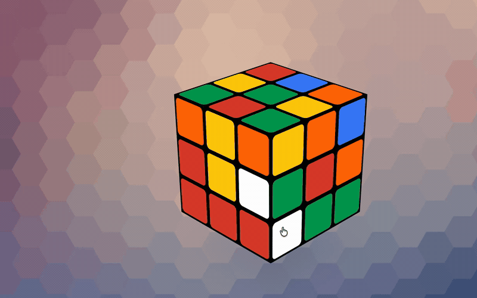

# Workshop Wallpaper Bridge

[](Package.swift)
[](README.ko.md)
[](LICENSE)
[](https://github.com/3x-haust/workshop-wallpaper-bridge/releases)

지원되는 Wallpaper Engine Workshop 콘텐츠를 macOS에서 배경화면처럼 사용합니다.

Workshop Wallpaper Bridge는 Wallpaper Engine Workshop 프로젝트를 Mac 전용 로컬 라이브러리로 가져오고, 지원되는 월페이퍼를 데스크톱 레이어에서 재생합니다. 복사한 폴더 가져오기와 로컬 재생은 그대로 유지합니다. Steam 연동은 정상 Steam 인증과 계정 권한 내에서 앱 ID `431960`의 Steam Workshop(창작마당) 항목 검색·다운로드를 제공합니다. 원본으로 복사해 온 Workshop 폴더는 수정하지 않습니다.

[웹사이트](https://3x-haust.github.io/workshop-wallpaper-bridge/) · [English](README.md) · [기여 안내](CONTRIBUTING.md) · [보안 정책](SECURITY.md) · [릴리즈](https://github.com/3x-haust/workshop-wallpaper-bridge/releases) · [후원](https://www.patreon.com/c/3xhaust)

## 빠른 링크

- [다운로드](#다운로드): 최신 DMG를 설치합니다.
- [사용 방법](#사용-방법): 복사한 Workshop 폴더를 가져오거나 로컬 영상을 추가합니다.
- [Steam 창작마당](#steam-창작마당개발-중): 인증 기반 검색·다운로드, 저장 위치, 현재 검증 상태를 확인합니다.
- [지원 범위](#지원-범위): 지원되는 월페이퍼 유형을 확인합니다.
- [소스에서 빌드](#소스에서-빌드): 앱을 로컬에서 실행하거나 DMG를 패키징합니다.
- [메인테이너와 기여자](#메인테이너와-기여자): 프로젝트 메인테이너와 기여자 목록입니다.

## 데모




큐브는 조작 가능한 웹 월페이퍼입니다. 드래그로 시점을 돌리고 클릭으로 큐브의 면을 회전합니다. macOS에서 **재생 및 조작**을 켜고 촬영한 화면이며, 사용자가 제공한 영상만 허락받아 공개합니다. 원본 Workshop 프로젝트는 포함하지 않습니다.

## 후원

Workshop Wallpaper Bridge가 도움이 되었다면 [Patreon](https://www.patreon.com/c/3xhaust)에서 호환성 개선과 유지보수를 후원할 수 있습니다.

## 다운로드

[Releases](https://github.com/3x-haust/workshop-wallpaper-bridge/releases)에서 최신 `WorkshopWallpaperBridge-macOS-arm64.dmg`를 받습니다.

1. DMG를 엽니다.
2. **Workshop Wallpaper Bridge.app**을 **Applications**로 드래그합니다.
3. Applications에 복사한 앱의 다운로드 quarantine을 제거합니다.

   ```bash
   xattr -r -d com.apple.quarantine "/Applications/Workshop Wallpaper Bridge.app"
   ```

4. 앱을 엽니다. Dock 앱이 아니라 메뉴바 유틸리티로 실행됩니다.

현재 공개 빌드는 유료 Apple Developer 계정이 없어 Apple 공증 대신 ad-hoc 서명을 사용합니다. 따라서 quarantine을 제거하지 않으면 macOS가 다운로드한 앱이 손상되었다고 표시할 수 있습니다. 이 저장소의 공식 [Releases](https://github.com/3x-haust/workshop-wallpaper-bridge/releases) 페이지에서 받은 DMG에만 위 명령을 사용하세요.

**Auto-check Updates**가 켜져 있으면 앱이 GitHub Releases에서 업데이트를 자동 확인합니다. 설정 창의 **Check Updates** 또는 메뉴바 메뉴의 **Check for Updates**로 수동 확인할 수 있습니다. 새 릴리즈가 있으면 **Download Update**가 최신 DMG를 다운로드합니다.

## 사용 방법

로컬에 복사한 Wallpaper Engine 프로젝트를 쓰는 경우:

1. Windows에서 Workshop 폴더를 찾습니다.

   ```text
   C:\Program Files (x86)\Steam\steamapps\workshop\content\431960
   ```

2. `431960` 폴더를 Mac으로 복사합니다.
3. 메뉴바 아이콘에서 **Workshop Wallpaper Bridge Settings**를 엽니다.
4. **내 배경화면 → 로컬 파일 가져오기**를 열고 **Browse**를 눌러 복사한 `431960` 폴더를 선택한 뒤 **Scan**을 누릅니다.
5. 지원되는 항목을 선택하고 **Import Selected**를 누릅니다.
6. **내 배경화면**에서 가져온 항목을 선택하면 적용됩니다. 상세 화면의 **데스크톱에서 재생** 버튼도 사용할 수 있습니다.

- 스캔 목록은 기본적으로 macOS 폴더 **Date Added** 값을 기준으로 최신순 정렬됩니다(읽을 수 없으면 수정일을 fallback으로 사용).
- 알파벳순으로 보고 싶으면 정렬을 **Name**으로 바꿀 수 있습니다.
- Import 이후 새로 복사되어 다음 Scan에서 발견된 항목에는 **NEW** 배지가 붙습니다.

직접 가진 영상을 쓰려면 Workshop 폴더를 스캔하지 않고 **Add Video File**을 누릅니다.

표시 방식:

- **Fit**: 전체 월페이퍼를 보존합니다.
- **Fill**: 화면을 꽉 채우며 가장자리가 잘릴 수 있습니다.
- **Stretch**: 화면 크기에 정확히 맞추며 이미지가 왜곡될 수 있습니다.

### 여러 화면 사용

- **화면**에서 모니터를 고른 뒤 배경화면을 선택하거나 **데스크톱에서 재생**을 누릅니다. **선택 화면 정지**는 선택한 화면만 정지합니다. **설정**과 메뉴바에서도 같은 화면 선택·표시 방식 제어를 사용할 수 있습니다. **화면 식별**은 각 화면에 번호와 이름을 잠깐 표시합니다. 선택기에는 픽셀 크기·배율·주 화면 여부도 표시됩니다.
- **연결된 모든 화면**을 고르면 같은 배경을 일괄 적용합니다. 화면마다 독립적으로 재생하며, 프레임 동기화 복제나 여러 화면을 잇는 하나의 큰 캔버스는 지원하지 않습니다.
- Fit/Fill/Stretch는 첫 배경을 할당하기 전에도 화면별로 기억합니다. 화면을 고르는 것만으로 설정이 바뀌지 않습니다. **서로 다름**은 선택 화면들의 표시 방식이 다르다는 뜻이며, 방식을 직접 고르면 선택한 화면들에 적용합니다. 새 배경을 재생해도 화면별 표시 방식은 유지하며 렌더링된 씬 영상은 항상 aspect-fill입니다.
- 설정은 번호·위치·이름이 아닌 macOS 화면 UUID에 연결합니다. 배치·주 화면·배율 변경 시 기존 재생을 유지합니다. 연결 해제 시 해당 화면의 재생 자원만 정리하며, 재연결·앱 재시작 때 설정을 복원합니다. 정지한 화면은 정지 상태를 유지합니다. 처음 보는 화면에는 다른 화면의 배경을 임의로 옮기지 않습니다. 도킹 장치나 어댑터 변경으로 UUID가 바뀌면 화면을 골라 다시 적용하세요.
- 자동 일시정지는 화면마다 따로 판단합니다. 절전은 저장된 배경을 바꾸지 않고 잠시 재생만 멈춥니다. 오디오와 조작 토글은 모든 화면에 공통으로 적용합니다.
- 여러 화면에 적용할 때는 모든 새 재생 창을 먼저 준비합니다. 준비에 실패하면 기존 배경과 설정을 그대로 유지합니다.
- 메뉴바의 **Stop Playback**은 연결 해제된 화면까지 모두 정지합니다. **Set Still Wallpaper**와 화면 보호기는 화면별 데스크톱 재생과 별개인 시스템 전체 기능으로 유지됩니다. 화면 보호기는 마지막으로 수동 재생하거나 순환으로 바뀐 배경을 따르며 재시작 후에도 그 선택을 복원합니다.

재생 동작:

- Dock과 Space 전환 깜빡임을 줄이기 위해 기본값은 연속 재생입니다.
- **Auto-pause behind apps**는 선택 옵션입니다.
- **Play wallpaper audio**는 기본적으로 꺼져 있습니다(이전 버전과 동일한 무음 재생). 켜고 볼륨 슬라이더를 조절하면 동영상 월페이퍼의 오디오와, scene 월페이퍼의 경우 캐시된 scene 비디오에 함께 구워진 배경음악/환경음을 들을 수 있습니다.
- 자동 일시정지와 오디오 설정은 즉시 적용됩니다. 월페이퍼가 다른 앱에 가려져 자동 일시정지되면 소리도 함께 멈춥니다.
- **실시간 씬 우선 재생**은 전체 구성을 네이티브 renderer로 처리할 수 있을 때 지원되는 스크립트를 실행합니다. 지원되는 미디어 씬은 렌더링 배경 위에 음악 정보를 실시간으로 표시하며, 그 외 복잡한 씬은 영상 경로를 유지합니다. [실시간 재생·직접 조작·오디오 설정 안내](docs/scenescript-compatibility.md#running-it).
- 설정창을 닫아도 재생은 멈추지 않습니다.
- **Open at Login**을 켜면 로그인 후 마지막 월페이퍼를 복구합니다.
- **Play on Desktop**은 macOS 데스크톱 사진을 바꾸지 않습니다. 그래서 투명 메뉴 바 색은 현재 시스템 배경화면 기준으로 유지됩니다.
- macOS 데스크톱 및 Lock Screen 정적 이미지를 실제로 바꾸고 싶을 때만 **Set Still Wallpaper**를 사용합니다.
- **Remove**는 확인 뒤 Mac 라이브러리 사본과 같은 항목의 완료된 Workshop 다운로드·재생 캐시를 함께 정리하며 휴지통을 우선 사용합니다. 원본 폴더·원본 영상·엔진 자산·Steam 인증 정보는 지우지 않습니다.

탐색 창의 왼쪽 메뉴에는 **탐색**, **내 배경화면**, **설정**이 있습니다. 받은 항목은 별도 다운로드 탭 없이 **내 배경화면**에서 관리합니다. 탐색과 로컬 라이브러리는 썸네일 격자와 큰 미리보기·상세 정보를 표시하며, 작은 창에서는 상세 화면을 별도로 엽니다. 기존 로컬 가져오기·표시 방식·재생·순환·삭제 기능은 유지합니다. **영상 변환**과 **정적 배경화면 설정**은 항목 상세와 라이브러리 우클릭 메뉴에서 사용할 수 있습니다. 설정에는 기존 재생·오디오·씬 엔진 자산·화면 보호기·언어 기능이 있습니다. [화면 디자인 안내](DESIGN.md)를 참고하세요.

Settings 탭의 **Language** 선택기로 앱 UI 텍스트를 **System**, **한국어**, **简体中文**, **English** 사이에서 전환할 수 있습니다. 앱을 재시작하지 않아도 즉시 적용되며, 버튼·섹션 제목·안내 문구 등 정적 UI 문구만 번역 대상이므로 앱 실행 중 생성되는 상태 메시지는 영어로 표시될 수 있습니다. **System**을 선택하면 macOS 언어가 한국어 또는 간체 중국어일 때 해당 번역을 쓰고, 그 외 언어는 영어로 표시됩니다.

라이브러리 순환(로테이션):

- **Rotate Library**를 켜면 Mac 라이브러리의 재생 가능한 월페이퍼를 타이머에 맞춰 순서대로 자동 전환합니다.
- **Shuffle**은 순서를 무작위로 섞고, **Rotate Every**로 간격(30초·1분·5분·15분·30분·1시간)을 정하며, **Next**로 즉시 다음으로 넘어갑니다.
- 설정창과 메뉴바 양쪽에서 제어할 수 있습니다. 켜짐/꺼짐·셔플·간격 설정은 앱을 다시 켜도 유지되고 로그인 후 자동으로 재개됩니다.
- 순환은 시작할 때 선택한 화면들을 대상으로 합니다. 이후 다른 화면을 선택해도 대상이 옮겨지지 않습니다. 수동 재생이나 **선택 화면 정지**는 그 화면들만 순환에서 제외하고 나머지는 계속 순환합니다. 남은 순환 대상과 고정 배경은 재시작 때 각각 복원합니다. 메뉴바 **Stop Playback**은 전체를 정지합니다. 재생 불가 항목은 자동으로 건너뜁니다.

가져온 파일은 아래 위치에 저장됩니다.

```text
~/Library/Application Support/WorkshopWallpaperBridge
```

### Steam 창작마당(개발 중)

Steam 연동은 개발 중이며, 패키징된 앱의 로그인부터 재생까지 전체 흐름은 아직 미검증입니다. 최신 공개 릴리즈에 포함되어 있다는 뜻은 아닙니다.

1. **탐색**을 열고 왼쪽 아래 Steam 계정 버튼에서 QR 코드 또는 Steam 계정과 Steam Guard로 로그인합니다. Wallpaper Engine(앱 ID `431960`)에 대해 해당 계정이 접근 권한을 가진 콘텐츠만 받습니다.
2. 썸네일을 둘러보거나 검색하고 인기·최신·평가순으로 정렬합니다. **필터**에서 연령·형식·장르·해상도와 검수 승인·오디오 반응 등의 기능을 포함·제외·무관으로 조합합니다. 기본값은 전체 이용가만 포함하고 주의 필요·성인을 제외하며, 초기화하면 이 값으로 돌아갑니다. 설정은 앱을 다시 켜도 유지됩니다. 작품 태그가 부정확할 수 있으며 Steam 커뮤니티 콘텐츠 설정은 별개입니다. 숫자 버튼으로 페이지를 선택하며 현재 페이지는 강조됩니다. 페이지를 성공적으로 바꾸면 목록 맨 위로 이동합니다. 항목을 선택하면 미리보기와 상세 정보가 표시됩니다. 현재 검색 결과에서 이미 상세 정보를 받은 항목을 다시 선택하면 서버를 다시 기다리지 않고 표시합니다. 검색·페이지·필터 변경이나 재로그인을 시작하면 이 메모리 캐시를 비웁니다. 호환성 안내는 미리보기 도움말에서 확인하며 지원 배지와 문제 목록은 그대로 표시됩니다.
3. **다운로드 후 적용**을 누르고 진행률을 확인합니다. 취소하거나 재시도할 수 있습니다. 일반 요청이나 프로젝트 검사 실패는 유효한 Steam 로그인을 유지합니다. 다운로드 취소는 보조 프로그램을 종료하지만, 로그인된 상태였다면 저장된 인증으로 한 번 자동 재연결합니다. 예기치 않은 연결 종료도 같은 방식으로 복구하며 실패하면 수동으로 다시 연결합니다. 명시적인 로그아웃과 로그인 자체의 취소는 자동 재연결하지 않습니다.
4. 명시적인 완료 응답과 저장소 검증을 거친 프로젝트만 **내 배경화면**에 보관합니다. 일부만 받았거나 취소된 항목은 완료 항목이 아닙니다.
5. **다운로드 후 적용**에는 라이브러리 가져오기와 필요한 씬 렌더링이 포함됩니다. 준비가 끝나면 적용하며, 다음 적용부터 유효한 렌더 캐시를 재사용합니다. 별도의 창 전체 하단 상태줄 없이 탐색과 좁은 창의 상세 화면에서 진행률·오류·취소·재시도를 확인할 수 있습니다. 배경화면을 정지하려면 메뉴 막대 메뉴의 **Stop Playback**을 사용합니다. 씬 영상 생성 실패는 다운로드 실패와 구분하여 표시하며 저장된 라이브러리 사본과 기존 배경화면은 유지합니다. 준비를 취소하면 적용하지 않지만 실행 중인 공유 렌더 작업은 캐시 생성을 마칠 수 있으며, 그동안 해당 항목의 삭제는 막습니다. 같은 항목 ID가 이미 있으면 기존 라이브러리 사본을 연결·선택하며 덮어쓰지 않습니다.
6. 지원되는 설치 항목은 선택하면 바로 적용됩니다. 미지원 항목도 상세를 확인할 수 있으며, 추가 변환은 **내 배경화면**에서 진행합니다. 새 콘텐츠가 준비되기 전에는 이전 배경화면을 유지합니다. 아래 지원 범위가 그대로 적용됩니다.

**다운로드 성공은 재생 성공이 아닙니다.** 미지원 형식·씬 기능이나 엔진 자산 누락으로 재생되지 않거나 미리보기만 표시될 수 있습니다. 이 연동은 공식 Wallpaper Engine 호환성을 보장하거나 기존 씬 지원 범위를 넓히지 않습니다.

다운로드는 가져온 라이브러리 사본과 별도로 저장합니다.

```text
~/Library/Application Support/WorkshopWallpaperBridge/WorkshopDownloads
```

#### 저장 인증과 로그아웃

인증은 앱을 다시 실행해도 유지되도록 앱 전용 파일에 영구 저장합니다.

```text
~/Library/Application Support/WorkshopWallpaperBridge/Steam/credentials.json
```

- `Steam` 디렉토리는 `0700`, 인증 파일은 `0600` 권한을 사용합니다. **키체인이 아닌 영구 파일 저장 방식**입니다. 파일과 백업을 비밀 정보로 취급하세요. 파일 권한은 같은 사용자로 실행되는 다른 프로세스의 접근까지 막아 주지 않습니다.
- 앱을 켜면 저장된 인증으로 자동 연결합니다. 인증이 만료되거나 폐기되었으면 다시 로그인해야 합니다.
- **로그아웃**은 보조 프로그램의 세션과 자동 연결을 끄지만 저장 인증은 남깁니다. **다시 연결**하거나 로그인하면 자동 연결이 다시 켜집니다.
- **저장 인증 삭제**는 이 앱의 `Steam` 디렉토리에 있는 `credentials.json`과 원자적 저장이 중단되면 남는 임시 파일 `credentials.json.tmp` 두 파일만 삭제합니다. Steam 앱이나 다른 Steam 클라이언트의 인증·세션에는 영향을 주지 않으며, Steam 서버의 토큰을 폐기하는 기능도 아닙니다.
- 보고서나 로그에 인증 정보, QR 로그인 데이터, 토큰, Steam Guard 코드를 포함하지 마세요. [보안 정책](SECURITY.md)을 참고하세요.

Steam 보조 프로그램은 [SteamRE/DepotDownloader 3.4.0](https://github.com/SteamRE/DepotDownloader/tree/DepotDownloader_3.4.0) 기반의 별도 GPL 구성 요소이며, SteamKit을 정상 인증 클라이언트로 사용합니다. Steam 연동 앱 패키지에는 자체 런타임을 포함한 macOS arm64 보조 프로그램을 번들하는 방식으로, 일반 사용자는 이 연동을 위해 .NET을 설치하거나 CLI 명령을 실행할 필요가 없습니다.

## 지원 범위

| 프로젝트 유형 | 지원 |
| --- | --- |
| `.mp4`, `.mov`, `.m4v` 동영상 | 바로 재생하며 HEVC `hev1` 영상은 macOS용 `hvc1` 사본으로 무손실 재포장해 캐시 |
| `.webm`, `.mkv`, `.avi` 동영상 | 로컬 `ffmpeg`로 변환 후 재생 |
| `index.html` 웹 월페이퍼 | 로컬 WebView에서 마우스 조작, WebGL, 기본 사용자 설정, 시스템 오디오 콜백 지원 |
| `.jpg`, `.png`, `.gif`, `.heic` 이미지 | 정적 데스크톱 레이어로 표시 |
| `scene.pkg` 씬 월페이퍼 | 기본 이미지·텍스트 구성을 모두 처리할 수 있는 씬은 지원되는 스크립트를 실시간 실행합니다. 지원되는 미디어 씬은 렌더링 배경에 실시간 레이어를 합성합니다. 그 외 복잡한 씬은 영상으로 재생하며, 렌더링 중에는 호환 영상이나 미리보기를 유지합니다. |

scene 지원은 보수적입니다. 실시간 재생은 [SceneScript 호환 범위](docs/scenescript-compatibility.md)에 정리된 인터페이스를 제공하며, Windows 엔진 전체와의 호환을 보장하지 않습니다. 복잡한 씬은 네이티브 renderer에서 다르게 보일 수 있습니다.

**재생 및 조작**을 누르면 씬·웹을 마우스와 키보드로 조작할 수 있습니다. 조작 설정은 재시작 후에도 유지되며, 바탕화면 아이콘을 사용하려면 메뉴바에서 끄세요. 배경 창이 비활성 상태여도 큐브 초기화와 원소 확대 같은 웹 애니메이션이 진행됩니다. 클릭으로 요청한 온라인 설명은 **브라우저에서 열기** 버튼으로 볼 수 있으며, 월페이퍼 내부에서는 외부 리소스를 계속 차단합니다. **시스템 소리에 반응**은 macOS 캡처 권한을 받아 소리를 기기에서 분석하며 **Play wallpaper audio**와는 별도 설정입니다. 설정과 직접 작성한 예제는 [호환 범위 안내](docs/scenescript-compatibility.md)를 참고하세요.

### scene 재생 동작 방식

- 시스템 오디오 캡처 전에 권한을 확인합니다. 권한이 없을 때만 설정에 **권한 허용…** 버튼이 나타나고, 이미 허용됐으면 숨겨집니다. 시스템 설정의 변경을 자동으로 반영하며 재생할 때마다 권한을 다시 요청하지 않습니다.
- **실시간 씬 우선 재생**을 켜도 전체 구성과 텍스처 디코딩을 확인한 기본 이미지·텍스트 씬만 실시간 재생합니다. 효과, 파티클, 모델, 부모 레이어, 사용자 셰이더, 블룸, 미지원 스크립트 속성, 누락 또는 제한을 넘는 레이어가 있으면 영상 경로를 유지합니다. 일부만 그린 화면으로 기존 씬을 대체하지 않습니다.
- 미디어 오버레이 경로는 원본 캔버스 비율로 렌더링한 배경 위에 곡 정보·시계·표지 전환·낮밤 레이어를 실시간으로 표시합니다. 원본 패키지 셰이더로 표지 합성·글리치·CRT·픽셀화와 실시간 합성 레이어를 처리합니다. 아직 실험 단계이며 Windows와 화면·시간 동작이 같은지는 검증되지 않았습니다. [검증 내용과 제한](docs/scenescript-compatibility.md#summer-in-the-city).
- 그 외 씬은 처음 재생할 때 (번들되었거나 설정된 외부 GPL scene renderer와 `ffmpeg`를 이용해) scene을 화면에 보이지 않는 상태로(renderer 창은 절대 표시되지 않습니다) 렌더링해 반복 재생되는 mp4로 캐시합니다.
- 번들된 renderer가 지원하는 경우, 중간 PNG 프레임 파일 없이 프레임을 인코더로 동시에 스트리밍하여 첫 렌더링 속도를 눈에 띄게 높이며, 지원하지 않는 이전 renderer 빌드에서는 기존의 record-then-encode 방식으로 자동 대체됩니다.
- 캐시된 클립은 20초 분량이며, 인코딩 시 클립의 마지막 약 1.2초를 처음 약 1.2초와 크로스페이드해 이음매 자체를 자연스럽게 지웁니다(단순히 덜 자주 보이게 하는 데 그치지 않습니다).
- scene 패키지에 저작된 sound layer(배경음악, 환경음 등)가 있으면 해당 오디오를 `scene.pkg`에서 추출해 반복 재생되는 오디오 트랙으로 캐시된 비디오에 믹싱합니다. 오디오는 기본적으로 음소거 상태이며(**Play wallpaper audio**로 켤 수 있음), 비디오와 달리 이음매 크로스페이드가 적용되지 않아 반복 지점에서 미세한 이음매가 들릴 수 있습니다. 추출이 실패해도 무음 비디오가 생성됩니다.
- v8 캐시는 처음 재생한 화면의 크기·배율 대신 원본 씬 캔버스 비율로 기록합니다. 이전 v7/v6 영상은 다른 모니터에서 비율이 어긋날 수 있어 재사용하지 않으며, v8을 만드는 동안 프로젝트 미리보기를 유지합니다. renderer 기능 확인과 녹화 대기에는 시간 제한을 둡니다.
- 첫 렌더링이 진행되는 동안 앱 상태 표시줄에 "Rendering scene to video… N%" 형태로 실시간 진행률이 표시됩니다.
- 비디오 재생은 고정된 반복 영상이라 실시간 입력에 반응하지 않습니다. 스크립트는 기본 실시간 씬과 미디어 오버레이 경로에서 실행하며, 셰이더만으로 만든 오디오 반응은 스크립트 브리지의 지원 대상이 아닙니다.
- 캐시가 만들어지면 일반 동영상 월페이퍼 경로로 재생됩니다: `AVPlayerLooper` 기반의 끊김 없는 반복, 앱의 fit/fill/stretch 설정과 무관하게 항상 aspect-fill, 그리고 번들된 화면 보호기에서의 재사용(아래 화면 보호기 참고).

`wwbctl attach-scene-video <asset-id> <video-file>`는 여전히 진단이나 비교 workflow용 로컬 reference cache만 저장하며, 자동 렌더-투-비디오 캐시와는 무관합니다.

비디오 렌더링 경로에는 번들된 renderer subprocess, Homebrew 실행 라이브러리(`brew install lz4 sdl2 ffmpeg glfw glew mpv freetype`), 그리고 사용자가 자기 Windows 설치본에서 복사한 Wallpaper Engine runtime `assets` 폴더가 필요합니다(Workshop Wallpaper Bridge는 이 파일들을 다운로드하거나 함께 배포하지 않습니다):

- 앱에서: **Scene Engine Assets** -> **Choose Assets Folder...**에서 복사한 `steamapps/common/wallpaper_engine/assets` 내용 폴더를 선택하세요.
- CLI/개발 실행에서는 `WWB_SCENE_ENGINE_ASSETS_DIR=/path/to/assets`가 앱 설정보다 우선하며, 그 외에는 `~/Library/Application Support/WorkshopWallpaperBridge/wallpaper-engine-assets`를 확인합니다.
- 렌더링 구성 요소가 없으면 호환 캐시 영상, 완전하게 표시할 수 있는 기본 네이티브 씬, 프로젝트 미리보기 순으로 사용합니다.
- 캐시된 scene 비디오는 asset별로 `~/Library/Application Support/WorkshopWallpaperBridge/SceneVideoCache/`에 저장되며, 원본 `scene.pkg`가 바뀌면 자동으로 다시 만들어집니다.
- 인증 기반 창작마당 다운로드는 Wallpaper Engine runtime assets를 제공하지 않습니다. 이 프로젝트는 제작자 asset을 재배포하거나 Steam content를 번들하지 않습니다. renderer binary는 별도 GPL component이며 자체 source notice가 필요합니다.

**음악 정보 표시**는 이미 실행 중인 Music·Spotify의 곡명·표지·재생 시간을 읽으며 macOS 자동화 권한이 필요합니다. Spotify 표지는 HTTPS 이미지 서비스에서 불러옵니다.

### 네이티브 fallback renderer

지원되는 실시간 씬과 렌더링 구성 요소가 없는 기본 씬에서 사용합니다. 이미지·텍스트 디코딩 한도는 24개로 유지하며, 누락되거나 한도를 넘는 레이어가 있으면 일부만 표시하지 않고 미리보기를 유지합니다. 전체 레이어를 준비한 뒤에는 미리보기를 숨겨 투명 영역에 썸네일이 겹치지 않도록 합니다.

지원 항목:

- packed `.tex` texture: LZ4 block과 주요 DXT 형식.
- text layer와 속성별 SceneScript를 실행 시간 제한이 있는 별도 JavaScriptCore 프로세스에서 재생합니다. 시간·커서·오디오 버퍼·주요 벡터 연산·레이어 접근 등을 지원하며, 자세한 내용은 [인터페이스와 제한 표](docs/scenescript-compatibility.md#implemented-interfaces)를 참고하세요.
- position/scale/rotation/opacity keyframe, mirror 모드 keyframe 애니메이션은 ping-pong 루프로 재생.
- animated sprite-sheet (`texgif`) texture — RePKG에 문서화된 `TEXS0001`-`TEXS0003` frame container(회전된 sheet packing, frame별 재생 시간 포함)를 해석해 Core Animation frame sequence로 재생.
- puppet-warp 모델(`MDLV0013` skeleton — Wallpaper Engine이 물고기·캐릭터의 몸을 휘게 하는 포맷): mesh/bone/mirror 모드 bone 애니메이션까지 디코드해 CPU skinning으로 재생하므로 puppet 몸체가 뻣뻣하게 미끄러지지 않고 실제로 휘어집니다.
- scene 패키지에 들어있는 GLSL shader를 Core Image로 그대로 포팅한 shader effect: `spin`, `shake`, `waterripple`, `waterwaves`, `waterflow`, `scroll` — flow-map 기반 shake 덕분에 지느러미와 꼬리만 움직이며, scene 전체를 덮는 compose layer의 `waterripple` 같은 full-canvas warp는 아래 layer들로 분배되어 살아있는 keyframe 모션 위에 물결이 적용됩니다.
- 근사 처리되는 particle/glint effect: 단순 sprite/pulse-ring particle system은 Core Animation emitter로, `nitro` 계열 glint effect는 noise 기반 twinkle 근사로 재생.

이미지 레이어에 크기와 구조가 검증된 TEXB0003 MP4 영상 텍스처가 들어 있는 씬은 내장 이미지 해독기가 처리하지 못해도 외부 엔진 준비를 시도할 수 있습니다. 렌더링이 성공한 뒤에만 적용하며, 이는 네이티브 실시간 영상 지원이나 모든 영상 텍스처 씬의 호환성을 뜻하지 않습니다.

여전히 생략되거나 근사치인 항목: 복잡한 particle operator, masked effect composition, 스칼라 값 이외의 effect 속성 script, 전체 3D/model·animation API, 지원하는 전체 사각형 패스 이외의 custom shader pipeline, Music·Spotify 외 앱의 미디어 정보, sound layer 제어, 내장 MP4 video texture — 네이티브 scene engine이 해당 runtime 기능을 구현하기 전까지 Wallpaper Engine과 다르게 보일 수 있습니다. package analyzer가 effect file, shader file, shader uniform, SceneScript, particle, sound layer, audio-analysis input, video texture 같은 scene runtime 요구사항을 보존하므로 이 parity 작업을 정확히 겨냥할 수 있습니다.

`preview.jpg`, `thumbnail.jpg`, `cover.png` 같은 Workshop 미리보기 파일은 로딩 및 대체 화면으로 사용합니다. 재생에는 `scene.pkg` 내부 데이터를 읽으며, 씬을 온전히 표시할 수 없거나 캐시가 없는 씬을 렌더링하는 동안에는 미리보기를 유지합니다.

## 화면 보호기

**Animate Screen Saver**를 켜면 앱이 번들된 macOS 화면 보호기를 설치하고 현재 Mac host의 화면 보호기로 선택합니다.

화면 보호기에서 움직이는 것:

- Mac 라이브러리의 MP4, MOV, M4V 월페이퍼.
- **Add Video File**로 추가한 로컬 영상.
- 렌더링된 동영상 캐시가 있는 scene 월페이퍼(위 지원 범위 참고): 화면 보호기가 그 캐시된 mp4를 그대로 재사용하며, 백그라운드 렌더링이 끝나는 대로 다시 재생하지 않아도 정적 미리보기에서 자동으로 캐시된 동영상으로 바뀝니다.

정적 fallback을 쓰는 것:

- 변환 전 WebM, MKV, AVI.
- 웹 월페이퍼.
- 새 실시간 스크립트 씬을 포함해 동영상 캐시가 없는 scene 월페이퍼. 화면 보호기는 SceneScript를 실행하지 않습니다.

화면 보호기가 언제 시작되는지는 macOS가 제어합니다. 시작 시간과 암호 요구 시간은 System Settings > Lock Screen에서 정합니다. macOS가 선택된 화면 보호기를 시작하기 전까지는 일반 정적 잠금화면 배경이 보입니다.

**Set Still Wallpaper**로 정적 데스크톱 배경화면도 명시적으로 설정할 수 있습니다. MP4, MOV, M4V 파일은 작은 Workshop preview 대신 동영상에서 한 프레임을 추출해 사용합니다. **Play on Desktop**은 의도적으로 macOS 데스크톱 사진을 그대로 둡니다. 그래서 애니메이션 재생 중 메뉴 바 색이 갑자기 바뀌는 일을 피합니다.

## 소스에서 빌드

필요한 것:

- macOS 14 이상
- Xcode command line tools
- Swift 6 toolchain
- 별도 Steam 보조 프로그램을 빌드할 때 필요한 .NET 9 SDK(`net9.0`)
- 선택: WebM, MKV, AVI 변환용 `ffmpeg`

```bash
git clone https://github.com/3x-haust/workshop-wallpaper-bridge.git
cd workshop-wallpaper-bridge
swift run WorkshopWallpaperBridge
```

로컬 앱 번들과 DMG 빌드:

```bash
bash Scripts/package-app.sh
open "dist/Workshop Wallpaper Bridge.app"
```

생성 파일:

```text
dist/WorkshopWallpaperBridge-macOS-arm64.dmg
```

Steam 연동 패키지는 패키징 전에 별도 보조 프로그램을 빌드합니다.

```bash
bash Scripts/build-steam-helper.sh
bash Scripts/package-app.sh
```

`Scripts/build-steam-helper.sh`는 SteamRE/DepotDownloader 3.4.0 기반의 자체 런타임 포함 macOS arm64 보조 프로그램을 빌드하고, `Scripts/package-app.sh`는 이를 앱 번들에 통합합니다. 보조 프로그램 배포에는 GPL 라이선스와 대응 소스 고지를 함께 포함해야 합니다. .NET은 개발자 빌드 요건이며, 일반 사용자가 별도로 설치해야 하는 실행 요건이 아닙니다.

로컬 패키지에는 외부 GPL 씬 렌더러가 포함됩니다.

- `Scripts/package-app.sh`는 사용할 렌더러가 없으면 `Scripts/build-scene-renderer.sh`로 고정된 공개 소스를 빌드하며, 빌드가 실패하면 패키징도 중단합니다. 위에 안내한 렌더러 빌드·실행 의존성이 설치되어 있어야 합니다. 릴리스 CI도 패키징 전에 이 단계를 실행합니다.
- 기존 빌드를 쓰려면 `SCENE_RENDERER_BINARY=/path/to/wwb-scene-renderer`를 설정하거나 실행 파일을 `ExternalRenderers/wwb-scene-renderer`에 둡니다.
- 패키징 스크립트는 렌더러와 로컬 라이브러리를 앱 리소스로 복사하고, [3x-haust/wallpaperengine-mac-renderer](https://github.com/3x-haust/wallpaperengine-mac-renderer)의 [Scripts/scene-renderer.env](Scripts/scene-renderer.env)에 고정한 source ref와 source link를 담은 `Renderer Notices/GPL Scene Renderer Notice.txt`를 항상 씁니다.
- 다른 renderer build를 배포한다면 해당 공개 source에 맞게 `SCENE_RENDERER_SOURCE_URL`과 `SCENE_RENDERER_SOURCE_REF`를 설정하세요.

패키지는 Wallpaper Engine runtime assets를 절대 포함하지 않습니다:

- 본인의 Windows Wallpaper Engine `steamapps/common/wallpaper_engine/assets` 내용 폴더를 복사한 뒤, 앱의 **Scene Engine Assets** -> **Choose Assets Folder...**에서 선택하세요.
- CLI/개발 실행에서는 `WWB_SCENE_ENGINE_ASSETS_DIR`가 앱 설정보다 우선하며, 기본 fallback은 `~/Library/Application Support/WorkshopWallpaperBridge/wallpaper-engine-assets`입니다.
- `swift run wwbctl doctor`로 renderer binary와 필수 engine asset 파일의 사용 가능 여부를 확인할 수 있습니다.

`ffmpeg` 설치:

```bash
brew install ffmpeg
```

## CLI

스캔, 가져오기, 변환, scene 진단에는 `wwbctl`을 쓸 수 있습니다.

```bash
swift run wwbctl scan "/path/to/431960" --out index.json
swift run wwbctl import "/path/to/431960"
swift run wwbctl import-video "/path/to/video.mp4"
swift run wwbctl remove "<asset-id>"
swift run wwbctl convert input.webm --out output.mp4
swift run wwbctl scene-info "/path/to/scene.pkg"
swift run wwbctl scene-render-info "/path/to/scene.pkg"
swift run wwbctl scene-engine-info "/path/to/scene.pkg"
swift run wwbctl scene-parity-check "/path/to/scene.pkg" "/path/to/golden-frames"
swift run wwbctl doctor
```

공개 릴리즈를 서명/공증하려면 `Scripts/package-app.sh` 실행 전에 `SIGN_IDENTITY`, `NOTARY_PROFILE`, `REQUIRE_SIGNING=1`, `REQUIRE_NOTARIZATION=1`을 설정합니다. 릴리즈 workflow에는 `MACOS_DEVELOPER_ID_APPLICATION_CERTIFICATE_BASE64`, `MACOS_DEVELOPER_ID_APPLICATION_CERTIFICATE_PASSWORD`, `MACOS_NOTARY_APPLE_ID`, `MACOS_NOTARY_TEAM_ID`, `MACOS_NOTARY_PASSWORD` GitHub Secrets가 필요합니다.

## 문제 해결

바탕화면에 아무것도 보이지 않는 경우:

- 가져온 항목이 `playable`인지 확인합니다.
- **Stop**을 누른 뒤 **Play on Desktop**을 다시 누릅니다.
- 잠시 **Auto-pause behind apps**를 끕니다.
- 전체화면 앱 Space가 아니라 데스크톱을 보고 있는지 확인합니다.

월페이퍼가 흐리거나 잘려 보이는 경우:

- 전체 이미지나 영상을 보려면 **Fit**을 사용합니다.
- 화면을 꽉 채우고 가장자리 잘림을 허용하려면 **Fill**을 사용합니다.
- `scene.pkg` 항목이라면 unsupported particle, advanced script, shader, video texture를 쓰는지 확인합니다.

WebM, MKV, AVI 변환이 실패하는 경우:

```bash
brew install ffmpeg
```

화면 보호기 설정에 **Workshop Wallpaper Bridge**가 보이지 않는 경우:

- `swift run`만 쓰지 말고 패키징된 `.app`을 엽니다.
- **Animate Screen Saver**를 한 번 켭니다.
- `~/Library/Screen Savers/Workshop Wallpaper Bridge.saver`가 있는지 확인합니다.
- 목록이 바로 갱신되지 않으면 System Settings를 종료한 뒤 다시 엽니다.

화면 보호기 미리보기가 검은 화면인 경우:

- 최신 릴리즈를 설치합니다.
- **Animate Screen Saver**를 껐다가 다시 켭니다.
- **Screen Saver Settings**를 한 번 눌러 번들 화면 보호기를 다시 설치하고 선택합니다.
- 미리보기에 완전한 검은 화면 대신 무엇이 실패했는지 설명하는 흐릿한 텍스트가 보인다면, 그 메시지가 문제(예: 읽지 못한 이미지)를 알려주는 것입니다; 메시지 없는 순수 검은 화면은 설정 자체가 로드되지 않았다는 뜻이며 위 단계로 해결됩니다.

## 프로젝트 경계

Workshop Wallpaper Bridge는 월페이퍼 재생과 가져온 라이브러리를 로컬에 유지하며, 선택적으로 정상 인증을 통한 Steam 창작마당 접근을 제공합니다.

- 검색·다운로드는 Wallpaper Engine(앱 ID `431960`)과 로그인한 계정의 권한 범위로 제한합니다.
- Steam 인증, 계정 권한, DRM을 우회하지 않습니다.
- Steam 프로토콜을 모방하거나 사칭하지 않습니다. 별도 보조 프로그램의 정상 인증 SteamKit 클라이언트 사용은 허용하며, 금지된 프로토콜 모방과 구분합니다.
- 완전한 `scene.pkg` 런타임 또는 공식 Wallpaper Engine 호환성을 주장하지 않습니다. 다운로드만으로 재생 가능성이 입증되지는 않습니다.
- 제작자 asset을 업로드, 공유, 재배포하지 않습니다.
- 원본으로 복사해 온 Workshop 폴더를 수정하지 않습니다.
- Wallpaper Engine runtime `assets`를 다운로드하거나 번들하지 않습니다. 사용자가 위 안내대로 자신의 설치본에서 준비해야 합니다.

Workshop Wallpaper Bridge는 Valve, Steam, Wallpaper Engine과 관련이 없는 비공식 프로젝트입니다. Wallpaper Engine은 해당 소유자의 상표입니다.

## 메인테이너와 기여자

<!-- profile-roster:start -->
이 영역은 GitHub 사용자 프로필에서 자동 생성됩니다.

### 메인테이너

- <a href="https://github.com/3x-haust"></a> [유성윤](https://github.com/3x-haust) `@3x-haust`
- <a href="https://github.com/dev-di-tto"></a> [메타몽](https://github.com/dev-di-tto) `@dev-di-tto`

### 기여자

- <a href="https://github.com/3x-haust"></a> [유성윤](https://github.com/3x-haust) `@3x-haust`
- <a href="https://github.com/dev-di-tto"></a> [메타몽](https://github.com/dev-di-tto) `@dev-di-tto`
- <a href="https://github.com/cl1107"></a> [@cl1107](https://github.com/cl1107)
- <a href="https://github.com/lotgood"></a> [@lotgood](https://github.com/lotgood)
- <a href="https://github.com/ohjack83-lab"></a> [ohjack83](https://github.com/ohjack83-lab) `@ohjack83-lab`
<!-- profile-roster:end -->

## 라이선스

본 앱은 MIT 라이선스입니다. 별도 Steam 보조 프로그램은 [SteamRE/DepotDownloader 3.4.0](https://github.com/SteamRE/DepotDownloader/tree/DepotDownloader_3.4.0) 기반으로, 앱의 MIT가 아닌 해당 [GPL 라이선스](https://github.com/SteamRE/DepotDownloader/blob/DepotDownloader_3.4.0/LICENSE)를 따릅니다. 선택적인 외부 씬 렌더러에도 별도의 GPL 라이선스·소스 고지가 적용됩니다. 배포 시 각 라이선스를 유지하고 수정 사항을 포함한 GPL 구성 요소의 대응 소스를 제공해야 합니다.
